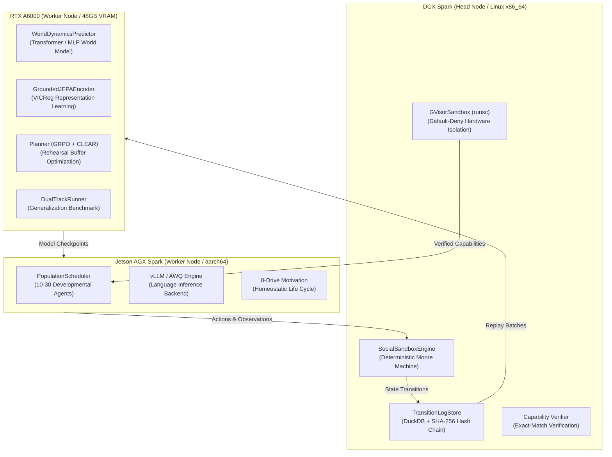

# Strategic Blueprint: Next Research & Engineering Frontiers for EvolZen

**Document Status**: Phase 0 Complete / Post-Horizon 4 Strategic Blueprint  
**Target Systems**: CPU Local Simulation, Ray Distributed Cluster, NVIDIA DGX Spark, Jetson AGX Spark, RTX A6000  
**Authors**: EvolZen Swarm Intelligence Team (`strategic-planner`)  
**Date**: November 2026  

---

## 1. Executive Summary & Verified Baseline State

With the sequential execution and rigorous verification of **Options 1–4** and **Horizons 1–4**, the EvolZen research testbed has achieved a battle-hardened foundation:

1. **Subsystem Verification**: 392 passing tests (1 skipped on Darwin host due to Linux-specific `runsc` gVisor sandboxing requirement), 0 mypy strict type errors across 144 source and test modules, clean `ruff` linting, and strict MkDocs documentation build.
2. **Empirical Telemetry**: 1,576 transition steps logged with cryptographic SHA-256 hash-chain integrity in `data/transitions.duckdb`, proving generational progression to generation 16 (empirically exceeding the Phase 1.2 $\ge 5$ generation milestone), 63 births, 65 deaths, 1,952 teaching events, and multi-niche CVTArchive coverage.
3. **Operational Tooling**: 7 operational CLI entrypoints (`run`, `train`, `evaluate`, `replay`, `inspect`, `ablate`, `cluster`), complete with an interactive HTML5/Canvas visualization dashboard (`dashboard.html`) and an automated multi-node pre-flight hardware diagnostic harness.

This blueprint articulates the next major research and engineering frontiers, categorizing immediate implementation steps, empirical campaigns, and physical GPU rig deployments into actionable tiers.

---

## 2. Deep Dive: The Four Next Major Frontiers

### Frontier 1: Longitudinal Cultural Evolution & Multi-Lineage Market Dynamics

#### Motivation & Research Questions
Current simulations validate multi-agent generational lifecycle transitions over short runs (5 generations, 1,576 ticks). However, biological and cultural evolutionary dynamics exhibit critical phase transitions, demographic bottlenecks, and institutional drift only over long-horizon evolutionary time:
1. **Demographic Replacement & Senescent Stability**: Under a developmental lifecycle ($A_{\text{adol}}=15, A_{\text{adult}}=25, A_{\text{elder}}=200, A_{\text{life}}=350$), does the population achieve steady-state birth-death equilibrium over 50–100 generations (10,000–50,000 world ticks), or does it succumb to extinction bottlenecks caused by senescence waves?
2. **Norm Diffusion & Provenance Integrity**: With `real_data_floor=0.2` in `ManualStore`, do human-authored foundational recipes (`ProvenanceCategory.HUMAN_AUTHORED`) persist against synthetic degradation and mutation over 50+ generations, or does cultural transmission suffer catastrophic noise accumulation (Henrich & Boyd 2002; Henrich & McElreath 2003)?
3. **Wealth Inequality & Gini Resilience Under Exogenous Resource Shocks**: When the environment experiences exogenous resource scarcity shocks (periodic regenerative droughts), does the decentralized double-auction economy buffer agents against starvation, or does it trigger wealth hyper-concentration ($\text{Gini} > 0.65$)?

#### Research Hypotheses & Target Metrics
- **Hypothesis 1.1 (Macro-Demographic Equilibrium)**: A 10–30 agent population seeded with diverse initial genomes (`sample_genome`) maintains non-zero living population and active lineages across 100 generations without external intervention.
- **Hypothesis 1.2 (Cultural Preservation Threshold)**: With vertical and oblique teaching active, human-authored crafting recipes maintain $\ge 80\%$ adoption fidelity across 50 generations when `real_data_floor \ge 0.2`.
- **Hypothesis 1.3 (Market Inequality Damping)**: Double-auction exchange with perishable goods dampens wealth Gini volatility by $\ge 25\%$ during drought shocks compared to an autarkic barter baseline.

---

### Frontier 2: Model-Based Policy Rollouts & Offline Planning (`evolzen train`)

#### Motivation & Research Questions
Currently, agents in `SocialSandboxEngine` select actions primarily through reflexive 8-drive satisfaction heuristics. `evolzen train` now jointly trains the `WorldDynamicsPredictor`, the `GroundedJEPAEncoder`, and the `Planner` using GRPO (Generalized Reinforcement Policy Optimization; Shao et al., 2024) and CLEAR rehearsal buffering (Rolnick et al., 2019). The next milestone is closing the loop:
1. **Model-Based vs. Reflexive Heuristics**: Do inference-time tree rollouts over the learned world model (`WorldDynamicsPredictor`) outperform reflexive heuristics on held-out procedural tasks in `DualTrackRunner` (Track 2 EAE_B action efficiency and solve rate)?
2. **Compounding Prediction Errors vs. Planning Horizon**: At what planning depth $H \in \{1, 3, 5, 10\}$ do errors in state prediction negate the benefits of search?
3. **Continual Learning & Catastrophic Forgetting**: Does CLEAR replay at ratio $r=0.5$ successfully preserve historical task competence as world distributions shift across generations, maintaining JEPA representation variance ($\sigma^2 > 10^{-4}$) across all 64 latent embedding dimensions?

#### Research Hypotheses & Target Metrics
- **Hypothesis 2.1 (Planning Advantage)**: Model-based rollouts at horizon $H=3$ achieve $\ge 15\%$ higher fresh task solve rate and lower step count than reflexive drive selection.
- **Hypothesis 2.2 (Rehearsal Stability)**: CLEAR replay ratio $r=0.5$ prevents policy collapse, maintaining policy entropy $H(\pi) \in [0.8, 2.5]$ and JEPA active dimension health $\ge 60/64$ after 100 GRPO updates.

---

### Frontier 3: Live Real-Time Dashboard Server (`evolzen serve`)

#### Motivation & Operational Architecture
While `evolzen inspect --export-html dashboard.html` provides rich post-hoc inspection of CVTArchive niche centroids and agent demographics, long-running simulations (hours or days) require real-time observability:
1. **Low-Overhead Streaming Architecture**: A dedicated `evolzen serve` command serving an asynchronous, event-driven web UI over localhost.
2. **Server-Sent Events (SSE) / WebSocket Pipeline**: Zero-copy tailing of `data/transitions.duckdb` in WAL mode, streaming live world tick metrics, population demography, Gini inequality curves, and archive centroid discoveries directly to the browser.
3. **Interactive Visual Diagnostics**:
   - Live 2D/3D projection of CVTArchive centroid occupancy (UMAP / PCA / parallel coordinates).
   - Real-time genealogical tree rendering showing active lineages and extinct branches.
   - Resource distribution heatmaps across grid locations.
   - Alert notifications for invariant violations, extinction warnings, or sandbox containment boundaries.

---

### Frontier 4: Physical Target Rig Deployment (Distributed Ray Topology)

#### Motivation & Rig Architecture
EvolZen is engineered to scale across heterogeneous hardware (`docs/hardware-deployment.md`). Physical deployment brings the full compute stack online:

1. **DGX Spark (Head Node)**: Manages central simulation orchestration, DuckDB transition logging, and gVisor microVM isolation coordinator for synthesizers.
2. **Jetson AGX Spark (Edge Agent Node)**: Executes 10–30 agent developmental loops and fast quantized LLM policy inference (`vllm` / `bitsandbytes`).
3. **RTX A6000 (Predictor & Evaluation Engine)**: Dedicated 48GB GDDR6 VRAM running continuous offline GRPO rollouts, Grounded JEPA representation updates, and dual-track held-out validation rounds.

---

## 3. Structured Actionable Roadmap

```mermaid
flowchart LR
    subgraph T1["Tier 1: Local CPU Immediate (0-48h)"]
        direction TB
        A1["evolzen serve CLI<br/>(Live SSE Dashboard)"]
        A2["Model-Based Planning Hook<br/>(Planner in DualTrackRunner)"]
        A3["Exogenous Resource Shocks<br/>(Engine Drought Injections)"]
    end

    subgraph T2["Tier 2: Empirical Campaigns (Days 2-7)"]
        direction TB
        B1["50-100 Gen Cultural Run<br/>(10k-50k Ticks, 10-30 Agents)"]
        B2["Predictor & JEPA Scaling<br/>(10k+ Transitions Benchmark)"]
        B3["Macro-Economic Stress Test<br/>(Gini Resilience under Drought)"]
    end

    subgraph T3["Tier 3: Physical GPU Deployment (Days 7-14)"]
        direction TB
        C1["Hardware Cluster Pre-Flight<br/>(DGX, Jetson, A6000 Probes)"]
        C2["gVisor Hardware Isolation<br/>(Linux runsc MicroVM Setup)"]
        C3["Ray Heterogeneous Cluster<br/>(Distributed Simulation Launch)"]
    end

    T1 --> T2 --> T3
```

### Tier 1: Local CPU Immediate (0–48 Hours)
*Zero additional hardware prerequisites; executes within the existing Mac/Linux CPU testbed.*

| Milestone | Subsystem | Action Items | Success Criteria |
|---|---|---|---|
| **1.1 Live Dashboard Server** | `evolzen.cli` | Implement `@app.command() def serve(port: int = 8000, db_path: Path = ...)` using Python's asynchronous HTTP/SSE server; stream live world ticks, Gini metrics, and population demography to the browser. | Browser connects to `http://localhost:8000`, receives live event stream, and renders real-time Canvas updates without UI freezing. |
| **1.2 Inference Planning Hook** | `evolzen.evaluation`, `evolzen.predictor` | Wire `Planner.plan(state)` into `DualTrackRunner` (Track 2) as an evaluatable policy alongside reflexive heuristics. | `uv run evolzen evaluate --rounds 4` reports comparative EAE_B metrics between reflexive and model-based planners. |
| **1.3 Exogenous Drought Injections** | `evolzen.environment` | Add configurable resource replenishment shock parameters (`drought_interval: int`, `drought_severity: float`) to `SocialSandboxEngine`. | Simulation runs demonstrate dynamic resource drops and subsequent demographic recovery or starvation. |
| **1.4 Test Suite Extension** | `tests/` | Add unit and integration tests for `serve`, planning hooks, and shock mechanics; ensure 100% test passing and strict type compliance. | `uv run pytest` passes (100% coverage on new code), `uv run mypy src tests` 0 errors. |

---

### Tier 2: Empirical Campaigns & Scaling (Days 2–7)
*Local multi-core and continuous batch runs to generate empirical research datasets.*

| Milestone | Target Scope | Execution Command | Key Measurements & Metrics |
|---|---|---|---|
| **2.1 Longitudinal Cultural Run** | 50–100 Generations, 10–30 Agents, 20k Ticks | `uv run evolzen run --generations 50 --ticks-per-gen 100 --db-path data/longitudinal.duckdb` | Population survival rate, max generation achieved, human vs synthetic recipe adoption ratio, CVTArchive niche coverage. |
| **2.2 Offline Model Training Campaign** | Ingest 20,000 Transitions from DuckDB | `uv run evolzen train --steps 100 --batch-size 32 --replay-ratio 0.5 --db-path data/longitudinal.duckdb` | GRPO step loss, policy entropy stability, JEPA representation variance ($\sigma^2 > 10^{-4}$), rehearsal buffer utilization. |
| **2.3 Generalization & Ablation Evaluation** | Dual-Track Held-Out Testing & 4-Cell Matrix | `uv run evolzen evaluate --rounds 10 && uv run evolzen ablate --steps 200 --output docs/research/ablation_results.md` | EAE_B action efficiency, generalization gap ($EAE_{\text{reused}} - EAE_{\text{fresh}}$), grounding vs ungrounded representation delta. |
| **2.4 Macro-Economic Shock Study** | 5 Shock Cycles across 50 Generations | Automated sweep script with varying drought severity ($0.2, 0.5, 0.8$) | Wealth Gini time series, starvation incidence, market trading volume before/during/after shocks. |

---

### Tier 3: Physical GPU Deployment & Distributed Cluster (Days 7–14)
*Multi-node heterogeneous physical rig orchestration across DGX, Jetson, and A6000.*

| Milestone | Node Target | Operations & Procedures | Verification Benchmark |
|---|---|---|---|
| **3.1 Rig Provisioning & Pre-Flight** | DGX Spark, Jetson AGX Spark, RTX A6000 | Clone repository, execute `uv sync --extra gpu`, install NVIDIA drivers (CUDA 12.4+), run `evolzen cluster --role <role>`. | All three nodes report `READY` status with zero subsystem degradation. |
| **3.2 gVisor Hardware Sandboxing** | DGX Spark & Jetson AGX Spark | Install official Google gVisor `runsc` binary; run `python -c "from evolzen.containment import is_gvisor_available; assert is_gvisor_available()"`. | Containment test suite `pytest tests/containment/test_sandbox.py` passes with hardware microVM execution. |
| **3.3 Ray Heterogeneous Cluster Launch** | Distributed Topology | Start Ray head node on DGX Spark (`ray start --head --port=6379`); join Jetson AGX (`--resources='{"agent_node": 1}'`) and RTX A6000 (`--resources='{"gpu_node": 1}'`). | `ray status` reflects 3 connected nodes, unified object store, and correct GPU/memory reservations. |
| **3.4 Live Multi-Agent vLLM Simulation** | End-to-End Pipeline | Launch distributed simulation running agent policies via vLLM on Jetson AGX, world Moore machine on DGX Spark, and real-time predictor GRPO training on RTX A6000. | Real-time continuous execution without memory leaks or network bottlenecks; streaming telemetry to `evolzen serve`. |

---

## 4. Safety Constraints, Scientific Integrity & Risk Mitigation

In strict adherence to `AGENTS.md` and repository safety standards:

1. **MicroVM Sandboxing Boundary (`AGENTS.md` Rule #1)**:
   - Any agent self-modification, dynamic DSL synthesis, or capability generation tested during exploration **must never execute outside `evolzen.containment.GVisorSandbox`**.
   - On hosts where `runsc` is unavailable (e.g. Darwin macOS development laptops), exploration tests must be strictly guarded with `pytest.importorskip` or degraded mock verification; live code execution without gVisor is strictly prohibited.
2. **Empirical Disclosure & Anti-Overclaiming (`AGENTS.md` Rules #4 & #5)**:
   - All claims regarding generalization, emergent norm stability, or intelligence must cite specific empirical metrics measured on physical runs or clearly carry the `[UNTESTED]` designation.
   - Long-horizon claims (50–100 generations) remain hypothetical until measured via Tier 2 and Tier 3 campaigns.
3. **Data Provenance & Real Data Floor**:
   - Cultural manual storage must strictly enforce `real_data_floor \ge 0.2` to prevent self-referential model collapse. Synthetic capabilities generated by agents must be tagged with `ProvenanceCategory.SYNTHETIC_DERIVED` and verified against exact-match ground truth.
4. **Dependency & Lockfile Integrity (`AGENTS.md` Rule #2)**:
   - All deployments utilize the single unified lockfile (`uv.lock`). GPU packages (`vllm`, `deepspeed`, `bitsandbytes`, `flash-attn`, `faiss-gpu`) are gated exclusively under `--extra gpu` to maintain a pristine, lightweight local CPU profile.

---

## 5. Summary & Next Actions

This strategic blueprint establishes an unambiguous, phased trajectory from our verified Phase 0 baseline to scaled empirical discovery and distributed physical hardware deployment. 

The swarm is ready to immediately initiate **Tier 1 (Local CPU Immediate)** engineering while scheduling **Tier 2 (Empirical Campaigns)** and provisioning target rigs for **Tier 3 (Physical Cluster Deployment)**.
