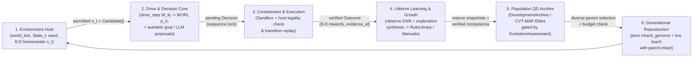

# Developmental agents: seven sins plus Null

**Design version:** eight-drive-v1, October 24, 2026 (workflow architecture upgraded November 12, 2026).
**Status:** a deterministic numerical baseline is implemented; no experiment has established
developmental intelligence, neural self-training, or population evolution.

## User-visible target

An agent is born as a child with its own randomized equation, acquires experience with age,
acts according to changing motivational ratios, learns from outcomes, and can be taught by living
parents. On maturation it can contribute temperament to a new child. A child does not receive
its parents' learned skills at birth. The world and host—not the agent—control permissions,
resource limits, clocks, births and authoritative outcome verification.

The original names are preserved: **pride, greed, lust, envy, gluttony, wrath, sloth, Null**.
These are fictional motivational coordinates, not moral ratings of agents or scientific
categories of humans. Lust means nonsexual attraction/affiliation in this implementation,
including all child-stage behavior. Reproduction is a population-management operation.
Null means no goal-directed engagement: waiting, resting or abstaining. It is not death,
depression, self-destruction, or a ninth drive.

## Read in order

1. [Finalized Agentic Behaviour Architecture](architecture.md): 5-layer target stack, original vs.
   literature comparison, and host synchronization invariants.
2. [Motivation mathematics](motivation.md): operational meanings, randomized equations,
   normalization, action ranking, limits and alternatives.
3. [Lifecycle and inheritance](lifecycle.md): age, competence, overlapping generations,
   parenting and population control.
4. [Learning and evolution](learning.md): memory, empirical updates, lessons, future LLM
   training, validation gates and archive selection.
5. [Evaluation protocol](evaluation.md): falsifiable questions, controls and development gates.
6. [Engineering and delivery](engineering.md): source map, interfaces, status and integration.
7. [Research evidence](evidence.md): sources actually inspected and what they do not establish.

## A brain is more than its equation

The equation sets *preferences*, not beliefs or abilities. In the baseline, the learner stores
context/action outcome estimates. In the proposed neural path, a shared pretrained model generates
candidate plans from private observations and evidence-linked memories; the motivational layer
ranks those plans. Outcomes revise beliefs and skills, while a promotion gate governs weight
updates. No free-form internal monologue is evidence that reasoning or learning occurred.

Four clocks must be distinguished: world ticks, decision count, learning-update count and
generation number. Age alone grants neither knowledge nor a larger LoRA rank. A newborn based on
a pretrained LLM is *locally inexperienced*, not linguistically blank or biologically childlike.

## What exists now

- validated, immutable records and JSON snapshots;
- seeded birth equations and bounded coefficient inheritance;
- lifecycle boundaries with terminal expiry;
- eight-drive context/age/momentum dynamics and normalized ratios;
- deterministic safe-candidate ranking, using personal experience and capped parental advice;
- feedback-dependent online numerical updates, finite memory, parent teaching while alive;
- a capacity-limited phenotype archive with host validation/safety/retention gates;
- source tests covering these primitives (results must be reported separately).

Implemented in Phase 1.1 & Phase 1.2 (`evolzen.environment`, `evolzen.agents`, `evolzen.schemas`):
- `SocialSandboxEngine`, `WorldState`/`ActionType` contracts, `TransitionLogStore`, `SocialSandboxAECEnv`, and host adapter (`evolzen.environment.adapter`).
- Unified developmental `Agent` runtime (`evolzen.agents.agent`), combining `AgentProfile` and the 8-coordinate numerical developmental core.
- Structured LLM inference (`evolzen.agents.inference.TransformersBackend`) with `outlines`-constrained generation and safe deterministic candidate fallback.
- `CVTArchive` Centroidal Voronoi Tessellation MAP-Elites scaling across $k$-D behavioral descriptors.
- Sandboxed capability self-modification (`evolzen.agents.self_modification`) gated by `evolzen.containment.Sandbox`.
- `PopulationScheduler` (`evolzen.agents.scheduler`) coordinating round-robin stepping, living-parent teaching, and DuckDB transition persistence.
- Legacy 5-axis `DriveVector` stubs cleanly retired per Option A consensus.

Not implemented: multi-generation empirical benchmarking runs on hardware pilot, private LoRA adapter training, and GPU tensor-parallel live serving via `VLLMBackend`.

## Upgraded agentic growth workflow architecture

To transition from the deterministic single-agent numerical core to multi-generational population
and world growth, all subsystems couple through a six-stage **host-mediated lockstep workflow**:

Design decisions anchoring this upgraded workflow:

1. **MORL + Homeostatic Utility Framing (`hayes2022morl`, `keramati2014homeostatic`):**
   `drive_step` generates normalized priority weights over internal/world discrepancies $x_t$,
   keeping preference weighting separate from outcome estimation (`SkillEstimate`) and host legality.
2. **Autotelic & Intrinsic Exploration Track (`merrick2010valuesystems`, `colas2022autotelic`, `oudeyer2007intrinsic`):**
   Because pure greedy ranking stalls in novel environments, exploration proposals (`exploration.actor`
   + `Candidate` generators) feed into the same verified pipeline under matched interaction budgets.
3. **Immutable Memory & Manual Layer (`library`, `economy`):**
   Verified skills persist in `evolzen.library.RuleLibrary` (append-only DuckDB + `ValidityContext`
   + `RegressionBank`), while falsifiable cross-agent knowledge flows via `economy.ManualStore` and
   living-parent `teach` without conflating advice with verified experience.
4. **High-Dimensional QD Scaling (`vassiliades2018cvtmape`, `diversitycollapse2026`):**
   Once behavioral descriptors exceed 2–3 dimensions (e.g., risk, reciprocity, specialization,
   exploration, communication), the archive upgrades from fixed uniform bins to CVT-MAP-Elites while
   monitoring topology coupling to avoid semantic collapse.
5. **Strict Execution Containment (`agache2020firecracker`, `sidikrokach2026`, `hyperagents2026`):**
   Any code-generating or metacognitive self-modification proposal executes exclusively inside
   `evolzen.containment.Sandbox` with static default-deny capability bounds.

See [ADR 0006](../../adr/0006-developmental-eight-drive-agents.md), [ADR 0008](../../adr/0008-convergent-learning-and-hierarchical-planning-upgrade.md), and the source package under
`src/evolzen/agents/`.
