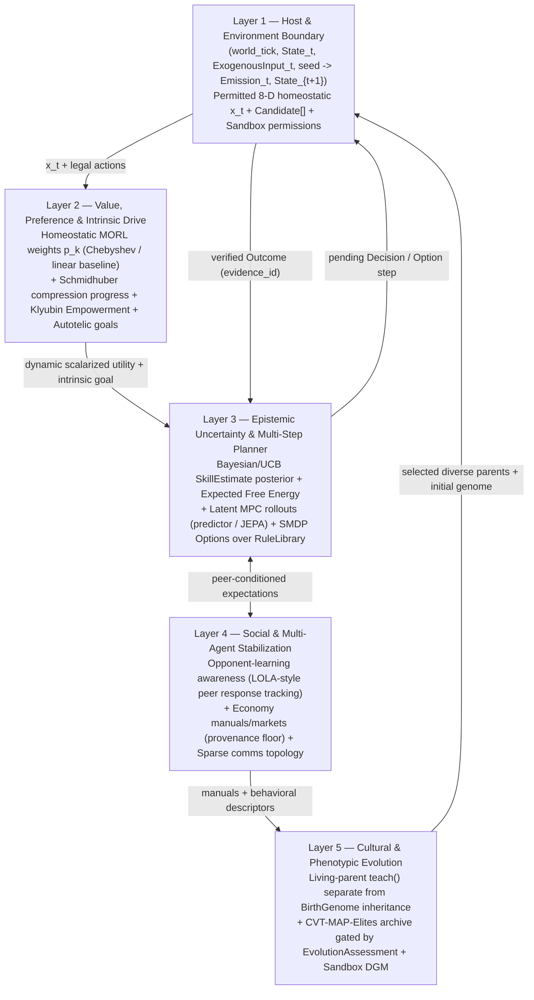

# Finalized Agentic Behaviour Architecture

**Status:** Target architecture finalized from IEEE/ML literature audit (November 12, 2026);
Tier-0 deterministic numerical core is implemented and tested, while Tier 1–3 upgrades remain
**proposed and empirically untested** pending `evolzen.environment` integration. Per
[`PRD.md §4`](../../PRD.md#4-non-goals) (`NG1`, `NG3`), this architecture targets bounded,
measurable behavioral convergence, sample efficiency, and multi-agent stability—not AGI.

---

## 1. Comparative Analysis: Original Design vs. Research Breakthroughs

| Original EvolZen Behavior Design | Weakness Identified by Literature | Research Breakthrough Replacing / Upgrading It | Finalized Architectural Decision |
|---|---|---|---|
| **Fixed 8×8 tendency matrix $W_{kj}$ over "seven sins + Null"** (`motivation.py`) | Subjective labels act as LLM prompt confounds; linear activation weights lack causal justification for internal drive dynamics | **Homeostatic RL** (`keramati2014homeostatic`, *eLife* 2014) + **Compression-Progress Intrinsic Reward** (`schmidhuber2010creativity`, *IEEE TAMD* 2010) + **Empowerment** (`klyubin2005empowerment`, *IEEE CEC* 2005) | Treat $W_{kj}$ strictly as a **neutral-label homeostatic priority modulator** ablated against intrinsic compression-progress and channel-capacity empowerment controls. |
| **Linear MORL scalarization** (`sum_k p_k * expected_outcome_k - cost`) | Provably misses Pareto-optimal choices on non-convex fronts (`hayes2022morl`, *AAMAS* 2022) | **Chebyshev Scalarization & Pareto Archives** (`vanmoffaert2014morl`, *JMLR* 2014) | Upgrade utility aggregation to **augmented Chebyshev scalarization** around a normalized utopia point $z^*$ (keeping linear sum as Tier-0 baseline). |
| **Point-estimate EMA + greedy argmax** (`observe` + `decide`) | Zero epistemic uncertainty tracking; traps permanently on suboptimal actions under wrong priors | **UCB** (`auer2002ucb1`), **Thompson Sampling** (`russo2018thompson`), **Mellowmax** (`asadi2017mellowmax`, *ICML* 2017) | Add posterior variance / sample uncertainty to `SkillEstimate` for sublinear regret exploration, plus non-expansive Mellowmax exploration ablations. |
| **1-step myopic candidate ranking** (`decide`) | No multi-step counterfactual rollout or temporal credit assignment | **Expected Free Energy** (`friston2015epistemic`, `parr2022activeinference`) + **DreamerV3 / TD-MPC2** (`hafner2025dreamerv3`, *Nature* 2025; `hansen2024tdmpc2`, *ICLR* 2024) | Route multi-step candidate planning through `evolzen.predictor` + `JEPAEncoder` latent MPC rollouts combining epistemic information gain and pragmatic utility. |
| **Atomic 1-tick primitive actions only** | Cannot reuse multi-step procedural skills from `RuleLibrary` | **SMDP Options Framework** (`sutton1999options`, *AI* 1999) + **Autotelic Goal Curricula** (`colas2022autotelic`, *JAIR* 2022) | Package verified `RuleEntry` skills as temporal-abstraction options `(I, pi, beta)` executed step-by-step under per-tick host legality checks. |
| **Independent agents in shared population** | Independent learners oscillate or collapse to defection in **Sequential Social Dilemmas** (`leibo2017ssd`, *AAMAS* 2017) and suffer semantic collapse (`diversitycollapse2026`, *ACL* 2026) | **LOLA Opponent-Awareness** (`foerster2018lola`, *ICLR* 2018) + **MARL Stability** (`busoniu2008marl`, *IEEE TSMC-C* 2008) + **CVT-MAP-Elites** (`vassiliades2018cvtmape`, *IEEE TEVC* 2018) | Condition policies on observed peer response signals, enforce sparse communication topologies, and scale QD selection via Voronoi cells. |

---

## 2. Finalized Five-Layer Agentic Behaviour Stack

---

## 3. Operational Invariants & Synchronization Rules

1. **Lockstep Host Authority:** No agent updates beliefs without a host-minted [`Outcome`](../../../src/evolzen/schemas/development.py#L136-L145) matched on `(agent_id, sequence, action_id)` and deduplicated on `evidence_id`. Preferences never override `Candidate.permitted`, age limits, resource budgets, or [`CapabilityGovernor`](../../../src/evolzen/containment/governance.py).
2. **Three Separate Inheritance Channels:**
   - *Genetic:* Numeric [`BirthGenome`](../../../src/evolzen/schemas/development.py#L62-L68) (`inherit_genome` with bounded mutation; zero weight crossover).
   - *Cultural:* Evidence-linked living-parent [`Lesson`](../../../src/evolzen/schemas/development.py#L158-L164) items and falsifiable [`Manual`](../../../src/evolzen/schemas/manual.py) entries (`economy`), never credited as own competence samples.
   - *Executable Skills:* Immutable, context-scoped [`RuleEntry`](../../../src/evolzen/schemas/library.py) records in [`RuleLibrary`](../../../src/evolzen/library/rule_library.py) verified against `RegressionBank` and executed exclusively inside [`Sandbox`](../../../src/evolzen/containment/sandbox.py).
3. **Sequential Social Dilemma Evaluation:** All cooperative/competitive drive hypotheses (`greed`, `gluttony`, `envy`, `wrath`, `lust`, `null`) must be evaluated in temporally extended multi-agent runs (`leibo2017ssd`) reporting resource health, inequality, and extinction—never extrapolated from one-shot static choices.

---

## 4. Implementation Status Mapping

- **Implemented now (Tier-0):** [`agents/development/`](../../../src/evolzen/agents/development/__init__.py) (`motivation.py`, `lifecycle.py`, `brain.py`, `learning.py`, `evolution.py`) + [`schemas/development.py`](../../../src/evolzen/schemas/development.py) (**32** verified test cases) and [`evolzen.library`](../../../src/evolzen/library/__init__.py) (**77** verified tests).
- **Target upgrades (Proposed / Untested):** Tier-1 UCB/Thompson + Chebyshev MORL (`ADR 0008`), Tier-2 Active Inference / latent MPC in `predictor.planner`, and Tier-3 SMDP options + opponent-aware MARL in `environment` / `agents`. Every tier enters code only with paired ablations against the Tier-0 baseline.

