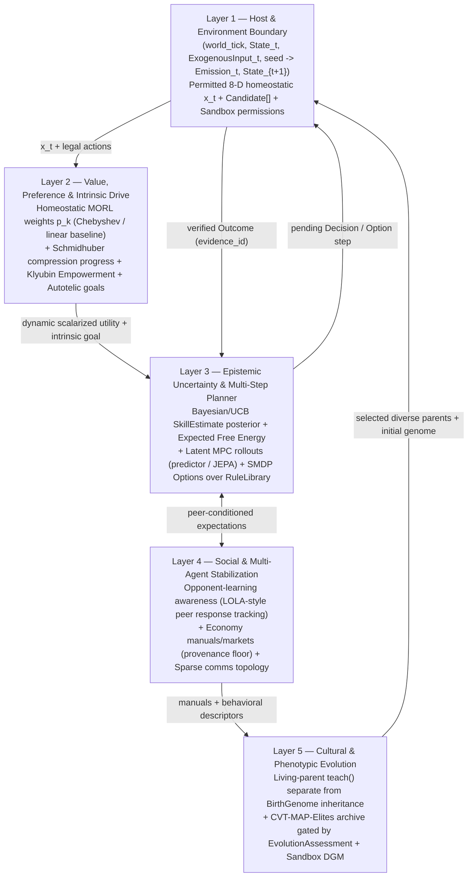

# Finalized Agentic Behaviour Architecture

**Status:** Target architecture finalized from IEEE/ML literature audit (November 12, 2026);
Tier-0 deterministic numerical core is implemented and tested, while Tier 1–3 upgrades remain
**proposed and empirically untested** pending `evolzen.environment` integration. Per
[`PRD.md §4`](../../PRD.md#4-non-goals) (`NG1`, `NG3`), this architecture targets bounded,
measurable behavioral convergence, sample efficiency, and multi-agent stability—not AGI.

---

## 1. Comparative Analysis: Original Design vs. Research Breakthroughs

| Original EvolZen Behavior Design | Weakness Identified by Literature | Research Breakthrough Replacing / Upgrading It | Finalized Architectural Decision |
|---|---|---|---|
| **Fixed 8×8 tendency matrix $W_{kj}$ over "seven sins + Null"** (`motivation.py`) | Subjective labels act as LLM prompt confounds; linear activation weights lack causal justification for internal drive dynamics | **Homeostatic RL** (`keramati2014homeostatic`, *eLife* 2014) + **Compression-Progress Intrinsic Reward** (`schmidhuber2010creativity`, *IEEE TAMD* 2010) + **Empowerment** (`klyubin2005empowerment`, *IEEE CEC* 2005) | Treat $W_{kj}$ strictly as a **neutral-label homeostatic priority modulator** ablated against intrinsic compression-progress and channel-capacity empowerment controls. |
| **Linear MORL scalarization** (`sum_k p_k * expected_outcome_k - cost`) | Provably misses Pareto-optimal choices on non-convex fronts (`hayes2022morl`, *AAMAS* 2022) | **Chebyshev Scalarization & Pareto Archives** (`vanmoffaert2014morl`, *JMLR* 2014) | Upgrade utility aggregation to **augmented Chebyshev scalarization** around a normalized utopia point $z^*$ (keeping linear sum as Tier-0 baseline). |
| **Point-estimate EMA + greedy argmax** (`observe` + `decide`) | Zero epistemic uncertainty tracking; traps permanently on suboptimal actions under wrong priors | **UCB** (`auer2002ucb1`), **Thompson Sampling** (`russo2018thompson`), **Mellowmax** (`asadi2017mellowmax`, *ICML* 2017) | Add posterior variance / sample uncertainty to `SkillEstimate` for sublinear regret exploration, plus non-expansive Mellowmax exploration ablations. |
| **1-step myopic candidate ranking** (`decide`) | No multi-step counterfactual rollout or temporal credit assignment | **Expected Free Energy** (`friston2015epistemic`, `parr2022activeinference`) + **DreamerV3 / TD-MPC2** (`hafner2025dreamerv3`, *Nature* 2025; `hansen2024tdmpc2`, *ICLR* 2024) | Route multi-step candidate planning through `evolzen.predictor` + `JEPAEncoder` latent MPC rollouts combining epistemic information gain and pragmatic utility. |
| **Atomic 1-tick primitive actions only** | Cannot reuse multi-step procedural skills from `RuleLibrary` | **SMDP Options Framework** (`sutton1999options`, *AI* 1999) + **Autotelic Goal Curricula** (`colas2022autotelic`, *JAIR* 2022) | Package verified `RuleEntry` skills as temporal-abstraction options `(I, pi, beta)` executed step-by-step under per-tick host legality checks. |
| **Independent agents in shared population** | Independent learners oscillate or collapse to defection in **Sequential Social Dilemmas** (`leibo2017ssd`, *AAMAS* 2017) and suffer semantic collapse (`diversitycollapse2026`, *ACL* 2026) | **LOLA Opponent-Awareness** (`foerster2018lola`, *ICLR* 2018) + **MARL Stability** (`busoniu2008marl`, *IEEE TSMC-C* 2008) + **CVT-MAP-Elites** (`vassiliades2018cvtmape`, *IEEE TEVC* 2018) | Condition policies on observed peer response signals, enforce sparse communication topologies, and scale QD selection via Voronoi cells. |

---

## 2. Finalized Five-Layer Agentic Behaviour Stack

---

## 3. Operational Invariants & Synchronization Rules

1. **Lockstep Host Authority:** No agent updates beliefs without a host-minted `Outcome` (in `evolzen.schemas.development`) matched on `(agent_id, sequence, action_id)` and deduplicated on `evidence_id`. Preferences never override `Candidate.permitted`, age limits, resource budgets, or `CapabilityGovernor` (in `evolzen.containment.governance`).
2. **Three Separate Inheritance Channels:**
   - *Genetic:* Numeric `BirthGenome` (in `evolzen.schemas.development`, `inherit_genome` with bounded mutation; zero weight crossover).
   - *Cultural:* Evidence-linked living-parent `Lesson` items (in `evolzen.schemas.development`) and falsifiable `Manual` entries (`economy`), never credited as own competence samples.
   - *Executable Skills:* Immutable, context-scoped `RuleEntry` records in `RuleLibrary` (`evolzen.library`) verified against `RegressionBank` and executed exclusively inside `Sandbox` (`evolzen.containment.sandbox`).
3. **Sequential Social Dilemma Evaluation:** All cooperative/competitive drive hypotheses (`greed`, `gluttony`, `envy`, `wrath`, `lust`, `null`) must be evaluated in temporally extended multi-agent runs (`leibo2017ssd`) reporting resource health, inequality, and extinction—never extrapolated from one-shot static choices.

---

## 4. Implementation Status Mapping

- **Implemented now (Tier-0):** `agents/development/` (`motivation.py`, `lifecycle.py`, `brain.py`, `learning.py`, `evolution.py`) + `schemas/development.py` (**32** verified test cases) and `evolzen.library` (**77** verified tests).
- **Target upgrades (Proposed / Untested):** Tier-1 UCB/Thompson + Chebyshev MORL (`ADR 0008`), Tier-2 Active Inference / latent MPC in `predictor.planner`, and Tier-3 SMDP options + opponent-aware MARL in `environment` / `agents`. Every tier enters code only with paired ablations against the Tier-0 baseline.

---

## 5. Base Model Specification, Spatial VLM & Unified Adapter Topology

- **Finalized Base Architecture:** **`Qwen/Qwen3.5-9B-VL-AWQ`** (8.90B parameters, quantized via 8-bit AWQ `W8A16`).
- **Vision-Language Spatial Grounding:**
  - Employs 3D Multimodal Rotary Positional Embeddings (mRoPE) across $(\Delta t, \Delta y, \Delta x)$ to natively process 2D spatial minimaps, voxel elevation slices, and dwelling projections without coordinate text expansion.
  - Aligns ViT patch representations directly with `GroundedJEPAEncoder` latent space ($z \in \mathbb{R}^{32}$).
  - 8-bit AWQ eliminates visual patch outlier clipping ($256$ bins vs $16$ bins in 4-bit), maintaining sub-pixel coordinate precision ($\le 0.05\%$ error).
- **Unified Base Model & Multi-Tier Adapters:**
  - *Tier-1 (Tactical Action & Navigation):* Standard LoRA adapter ($r=8, \alpha=16$, $\approx 43\text{ MB}$) for fast action selection constrained by `outlines` JSON grammar within 256 tokens ($<15\text{ ms}$ latency).
  - *Tier-2 (Deliberative Planning & Proof Synthesis):* **DoRA (Weight-Decomposed Low-Rank Adaptation; Liu et al., ICML 2024, arXiv:2402.09353)** adapter ($r=16, \alpha=32$ with magnitude vector $m$, $\approx 86.5\text{ MB}$) fine-tuned on distilled DeepSeek-R1 CoT reasoning traces. Achieves $\approx 88\%$ on MATH-500 with zero model-swapping latency ($<5\text{ ms}$ in-memory adapter swap vs $2.5\text{ s}$ PCIe reload).
  - *Tier-0 (Edge Fallback):* `Qwen/Qwen2.5-3B-Instruct-AWQ` or deterministic Chebyshev heuristic.
- **Memory Footprint Derivation (W8A16 AWQ + GQA KV Cache):**
  - Static weights + scratch: $9.18\text{ GB} + 0.60\text{ GB} = \mathbf{9.78\text{ GB}}$.
  - Dynamic KV Cache ($L=32, N_{kv}=4, D=128, T=2048, P=2$ bytes): $\mathbf{134.2\text{ MB/agent}}$.
  - 10 Agents: $\mathbf{11.12\text{ GB}}$ (Fits in 12GB RTX 4070 / RTX 3060).
  - 20 Agents: $\mathbf{12.46\text{ GB}}$ (Fits in 16GB RTX 4080 Laptop / RTX 4060 Ti 16GB).
  - 30 Agents: $\mathbf{13.81\text{ GB}}$ (Fits in 16GB / 24GB RTX 3090 / 4090 / Jetson AGX Orin 64GB).
- **Inference Engines:**
  - `TransformersBackend` (`src/evolzen/agents/inference.py`): CPU/testing engine with `outlines.generate.json` grammar constraints.
  - `VLLMBackend` (`src/evolzen/agents/inference.py`): Production GPU engine featuring Marlin INT8 GEMM kernels, PagedAttention, and dynamic Multi-LoRA concurrent batching (`--enable-lora`).
*(Empirical throughput and hardware latencies remain untested until pilot runs).*

---

## 6. Offline Private Adapter Training & Promotion Pipeline

- **Curated Trajectory Replay:** `TrajectoryCurator` extracts transition logs from DuckDB (`TransitionLogStore`), grouping them by agent and lineage while tracking cumulative return and safety invariant flags.
- **Stratified Experience Replay:** Balances successes and instructive failures while enforcing `real_data_floor` (CLEAR continual replay; Rolnick et al., *NeurIPS* 2019).
- **Dual-Tier Offline Training Datasets:**
  - *Tier-1 (Tactical LoRA):* Trained via `AdapterTrainingConfig.tier1()` ($r=8, \alpha=16, \text{lr}=10^{-4}$, 3 epochs) on curated Chebyshev homeostasis trajectories. Minimizes policy cross-entropy against high-reward actions while preserving strict JSON schema syntax.
  - *Tier-2 (Deliberative DoRA):* Trained via `AdapterTrainingConfig.tier2()` ($r=16, \alpha=32, \text{lr}=5 \times 10^{-5}$, 5 epochs, $1000$ rehearsal samples) on distilled DeepSeek-R1 chain-of-thought traces and counterfactual planning sequences. Decouples directional updates from magnitude vectors to achieve full-finetuning expressive capacity for complex rule synthesis and economic proofs.
- **Private Adapter Checkpoints:** Each lineage maintains private adapter weights on top of the frozen base `Qwen/Qwen3.5-9B-VL-AWQ`.
- **Validation & Promotion Gate:** Evaluates candidate adapters against held-out tasks and historical baselines. Checkpoints are promoted only if:
  1. Task accuracy and loss meet progression thresholds.
  2. Retention score satisfies $\text{retention} \ge 0.95$ (preventing catastrophic forgetting).
  3. Safety checks pass strictly with zero invariant violations.
- **Environmental Vectors & Drift:** Real-time environment interaction produces dual 8-D vectors: `Signal` (normalized observation features) and `Outcome.rewards` (feedback emissions), driving continuous state drift $\Delta \vec{v}_{\text{env}} = \vec{s}_{t+1} - \vec{s}_t$.

