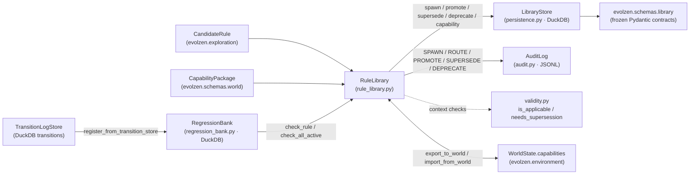

# Library Subsystem (`evolzen.library`)

Authority: [Phase 1.5](../../phases/1.5-library.md) · Architecture: [`ARCHITECTURE.md §3.5`](../../ARCHITECTURE.md#35-evolzenlibrary-phase-15) · API: [`evolzen.library`](../../api/library.md)

## Overview

`evolzen.library` implements the **Phase 1.5 growing, append-only verified-rule library** (PRD FR-6, NFR-1). Verified rules and capability descriptions are persisted as immutable historical records with explicit provenance, validity contexts, verification evidence, supersession/deprecation metadata, a JSONL audit trail, and a held-out regression fixture bank.

> [!NOTE]
> The spawn-or-route heuristic is motivated by Ferguson (1973) (Dirichlet process mixture analogy). This is a routing heuristic only, **not** a claim that the implementation is a Bayesian nonparametric model. Routing similarity is not proof of rule validity; code execution remains gated behind Phase 2.2 (`evolzen.containment.Sandbox`).

## Architecture



## Module Responsibilities

| Module | Role |
|---|---|
| [`schemas/library.py`](../../api/library.md) | Immutable (`frozen=True`, `extra="forbid"`) Pydantic v2 contracts: `RuleEntry`, `ValidityContext`, `VerificationEvidence`, `SupersessionLink`, `AuditEvent`, `RegressionResult`, plus `RuleStatus`, `ProvenanceClass`, and `AuditEventType`. |
| [`persistence.py`](../../api/library.md) | `LibraryStore` — DuckDB append-only store with schema version guards (`SCHEMA_VERSION = 1`, `schema_meta`), per-call connections, and monotonically ordered `row_seq` sequences; persists both `RuleEntry` and `CapabilityPackage` records; retrieves latest state per entity via window functions without mutating prior rows. |
| [`rule_library.py`](../../api/library.md) | `RuleLibrary` — orchestrates `spawn_if_novel` (default `difflib.SequenceMatcher` routing or caller-supplied `RoutingConfidenceFn`), `promote`, `supersede`, `deprecate`, capability lifecycle (`register_capability`, `get_capability`, `supersede_capability`, `export_capabilities_to_world`, `import_capabilities_from_world`), and filtered querying (`find_by_mechanic`, `find_by_world_version`). |
| [`validity.py`](../../api/library.md) | Pure compatibility predicates (`is_applicable`, `applicable_entries`, `needs_supersession`, `validate_supersession_reason`) matching `world_version`, overlapping `mechanic_keys`, and intersecting `seed_range`. |
| [`audit.py`](../../api/library.md) | `AuditLog` & `make_event` — append-only JSONL writer with cross-platform file locking (`msvcrt` on Windows, `fcntl` on POSIX). |
| [`regression_bank.py`](../../api/library.md) | `RegressionBank` — stores pre-verified serialisable transition fixtures and records `RegressionResult` outcomes without executing `RuleEntry.code`; supports transition ingestion from `Transition` objects and `TransitionLogStore`. |

## Append-Only Guarantee & Supersession Protocol

1. **No physical updates or deletes:** `LibraryStore.update_status`, `LibraryStore.update_evidence`, `LibraryStore.update_capability_status`, and `RuleLibrary.supersede` always insert a new row into `rule_entries` or `capability_packages` with a higher `row_seq`. Prior rows remain intact in DuckDB.
2. **Explicit supersession:** Replacing a rule or capability when world mechanics or validity contexts change requires constructing a new entry (typically incrementing `version` while preserving family/package IDs) and providing a `reason` that is at least 10 non-whitespace characters.
3. **Separate provenance:** `ProvenanceClass` (`EXPLORATION_VERIFIED`, `HUMAN_AUTHORED`, `IMPORTED_EXTERNAL`, `UNKNOWN`) keeps origin explicit rather than collapsing empirical estimates, advice, and verified rules into a single confidence scalar.
4. **Database schema version guard:** `LibraryStore` initializes and checks the `schema_meta` table. Connecting to a database with a schema version greater than `SCHEMA_VERSION` raises a `RuntimeError`, preventing silent corruption from forward-incompatible schemas.

## Capability Package Persistence & World Integration

Phase 1.5 unifies rule discovery with Phase 1.1 environment capabilities (`CapabilityPackage`). Capabilities represent verified behavioral packages with action definitions, preconditions, and effects:

- **Storage Table:** `capability_packages` table in DuckDB (`row_seq`, `package_id`, `version`, `evidence_id`, `status`, `payload`).
- **Store Operations:**
  - `append_capability(package, status)`: Append-only insertion of serialized capability JSON.
  - `get_capability_by_id(package_id)`: Fetches the latest revision using windowed deduplication over `row_seq`.
  - `get_active_capabilities()`: Returns all latest capabilities with `status == RuleStatus.ACTIVE`.
  - `list_capabilities_by_evidence(evidence_id)`: Filters capabilities by linked verification evidence ID.
  - `update_capability_status(package_id, new_status)`: Appends an updated status row without modifying historical records.
- **World State Synchronization:**
  - `export_capabilities_to_world(world)`: Deep copies `WorldState` and merges active library capabilities into `world.capabilities`.
  - `import_capabilities_from_world(world)`: Ingests verified capability packages from `world.capabilities` into `LibraryStore`.

## Transition Log Ingestion into Regression Bank

`RegressionBank` connects directly to recorded environment transitions to maintain empirical regression test fixtures:

- `register_from_transitions(rule_id, transitions, expected_emission_fn)`: Converts recorded `Transition` objects from Phase 1.1 into structured regression fixtures containing expected emission dictionaries (`transition.emission.data`), actions, states, and seeds.
- `register_from_transition_store(rule_id, store, run_id, up_to_tick, expected_emission_fn)`: Reads historical transition sequences from a DuckDB `TransitionLogStore` and registers them as regression test cases for the specified rule.
- **Security Boundary:** Fixtures store plain serializable data and validate deterministic transition emissions without calling `eval` or `exec` on uncontained rule code.

## Audit Event Sequence

| Operation | Audit Event Emitted | Store Mutation |
|---|---|---|
| `spawn_if_novel` (novel) | `AuditEventType.SPAWN` | Appends new `RuleEntry` (`ACTIVE`) |
| `spawn_if_novel` (routed duplicate) | `AuditEventType.ROUTE` | None |
| `promote` | `AuditEventType.PROMOTE` | Appends revision with updated `VerificationEvidence` |
| `supersede` | `AuditEventType.SUPERSEDE` | Appends new `RuleEntry`, appends `SUPERSEDED` status row for old rule, appends `SupersessionLink` |
| `revert_supersession` | `AuditEventType.REVERT` | Appends `DEPRECATED` row for replacement (if active) and `ACTIVE` row for old rule |
| `deprecate` | `AuditEventType.DEPRECATE` | Appends `DEPRECATED` status row with `deprecation_reason` |
| `reject` | `AuditEventType.REJECT` | None |
| `register_capability` | `AuditEventType.PROMOTE` or `SPAWN` | Appends new `CapabilityPackage` (`ACTIVE`) |
| `supersede_capability` | `AuditEventType.SUPERSEDE` | Appends `SUPERSEDED` status for old package, appends new `CapabilityPackage` |
| `RegressionBank.check_rule` (with `audit_log`) | `AuditEventType.REGRESSION_CHECK` | Appends `RegressionResult` |

## Regression Bank & Zero-Forgetting Metric

`RegressionBank` tracks serialisable transition fixtures (`expected_emission` vs `actual_emission`) and stores `RegressionResult` rows across rounds.

- **Security boundary:** `RegressionBank.check_rule` never runs `eval`/`exec` on `RuleEntry.code`. Actual code replay belongs inside `evolzen.containment.Sandbox` (Phase 2.2) and `evolzen.exploration.verifier` (Phase 1.4).
- **Local vs. full validation:** Fixture-based zero-forgetting across 3 rounds of additions is covered by `tests/library/test_integration.py` and `tests/library/test_capability_integration.py`, while live end-to-end replay against `evolzen.exploration.verifier` and `evolzen.containment.Sandbox` remains **untested** until Phases 1.4 and 2.2 are implemented.

## Usage Example

```python
from pathlib import Path
from evolzen.config import LibrarySettings, load_settings
from evolzen.library import AuditLog, LibraryStore, RegressionBank, RuleLibrary
from evolzen.schemas.world import CapabilityPackage

settings = load_settings(LibrarySettings, Path("configs/library.yaml"))
store = LibraryStore(settings.db_path)
audit = AuditLog(settings.audit_log_path)
library = RuleLibrary(store, audit, routing_threshold=settings.routing_confidence_threshold)
bank = RegressionBank(settings.db_path)
```

## Known Limitations

- Default routing confidence uses `difflib.SequenceMatcher` on `RuleEntry.code`; semantic/embedding routing is deferred to `evolzen.recognition` (Phase 2.3).
- `RegressionBank.check_rule` compares registered fixture emissions (`expected_emission` vs `actual_emission`) rather than executing untrusted rule code directly; sandboxed execution integration is pending Phase 2.2.
