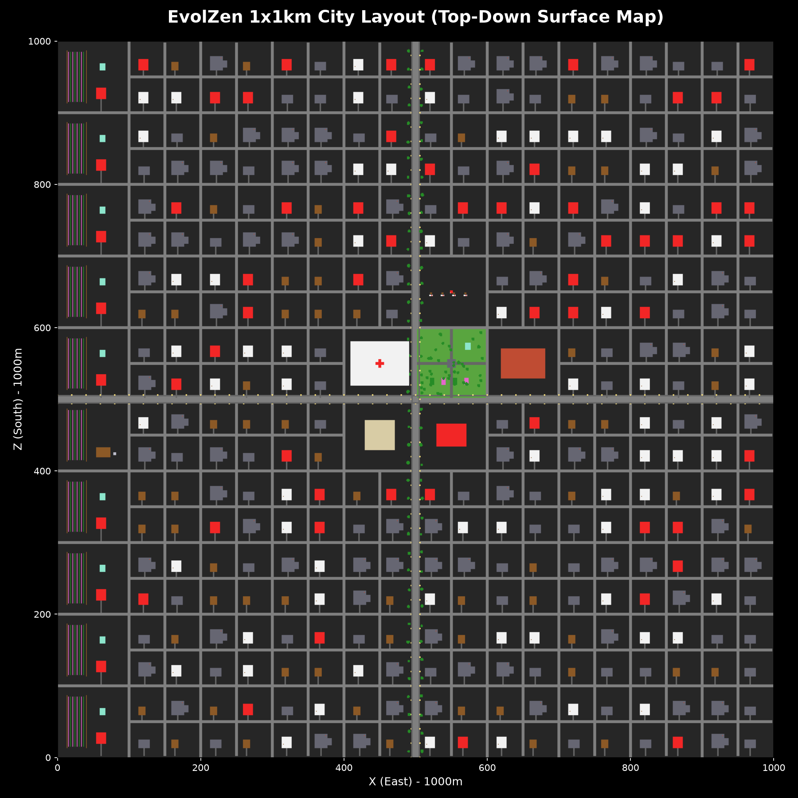

<div align="center">




# 🌍 EVOLZEN — 1×1 KM PARALLEL UNIVERSE

### *A mathematically-verified, strict-voxel world substrate for AGI-scale simulation.*

[]()
[]()
[]()
[]()
[]()
[]()
[]()
[]()
[]()
[]()

**THE STAGE IS BUILT. BUILD THE REALITY ON TOP OF IT.** 🏗️


*3.24 MP synthetic orthographic surface/material map — X-East horizontal, Z-South vertical.*

</div>

---

## 📑 TABLE OF CONTENTS

- [🌍 Overview](#-overview)
- [⚡ God-Tier Feature Matrix](#-god-tier-feature-matrix)
- [🗺️ World Zoning](#️-world-zoning)
- [🧱 Material Palette (24 IDs)](#-material-palette-24-ids)
- [🏘️ House Archetypes](#-house-archetypes)
- [🏛️ Civic Legend](#-civic-legend)
- [🧪 Verification Suite](#-verification-suite)
- [📐 Coordinate Convention & API](#-coordinate-convention--api)
- [📁 Repository Structure](#-repository-structure)
- [🚀 Quickstart](#-quickstart)
- [🤝 Handoff Mandates](#-handoff-mandates)
- [🧬 Philosophy & Role Boundary](#-philosophy--role-boundary)
- [🗓️ Changelog](#️-changelog)
- [❓ FAQ](#-faq)
- [🐛 Troubleshooting (M3 Air)](#-troubleshooting-m3-air)
- [🏆 Credits](#-credits)
- [📜 License & Citation](#-license--citation)

---

## 🌍 OVERVIEW

**EvolZen** is a procedurally generated, fully connected **1 km × 1 km parallel universe**, stored as a sparse voxel substrate at **25 cm resolution**. It is not a game level. It is a **certified spatial database** — a deterministic, reproducible world designed to be ingested by Metal/CUDA voxel renderers, NavMesh bakers, and AGI agent populations.

Every claim in this README is backed by an executed audit against the source `.npz` — **not by renders, not by vibes.**

> *"Source-audit verified"* = proven by executed audit output on the raw voxel data, reproducible by you in one command. This repo does not claim "independently audited." It claims something stronger.

---

## ⚡ GOD-TIER FEATURE MATRIX

| Feature | Spec | Status |
|---|---|---|
|  World Extent | 1,000 m × 1,000 m × 40 m (flat plain, implicit ground) | ✅ |
| 🧊 Voxel Resolution | 25 cm — high-res voxel aesthetic, never blurry | ✅ |
| 📦 Storage | 10,378 sparse 32³ chunks (`uint8`) | ✅ |
| 🔢 Voxel Capacity | 340,066,304 (inventory reconciles **exactly**) | ✅ |
| 🧱 Solid Matter | 19,979,678 voxels (5.87% density) | ✅ |
| 🌬️ Air | 320,086,626 voxels | ✅ |
| 🏘️ Houses | 345 — **5 distinct archetypes**, 345/345 wired to streets | ✅ |
| 🛣️ Street Network | Continuous orthogonal grid — 98.7% one connected component | ✅ |
| 🌾 Farms | 10 belts anchored **WEST** (crops, barns, silos, fences) | ✅ |
| 🏡 Greenhouses | 53 garden buildings (GLASS roofs + flower beds) | ✅ |
| 🏥 Civic Core | Hospital ✚ · School · Fire · Offices · Market | ✅ |
| 🌳 Park | Green mass, trees, flower beds, gazebo, greenhouse | ✅ |
| 💧 Water | **0 voxels** — mandate enforced at data level | ✅ |
| 🚗 Transport | **None** — pedestrian-only (CAR/TIRE/SAND reserved at 0) | ✅ |
| 🎲 Determinism | Seed 42 — identical universe on every run | ✅ |

---

## 🗺️ WORLD ZONING

```
WEST ◄────────────────────────────────────────────────────────► EAST
┌──────────┬───────────────────────────┬───────────────────────────┐
│ 🌾 FARM  │      🏘️ RESIDENTIAL       │       🏘️ RESIDENTIAL      │
│ BELT     │  (5 archetypes, walkways, │  (ranch · colonial ·      │
│ x < 100  │   roof-coded footprints)  │   mcmansion · bungalow ·  │
│ crops ·  │                           │   modern flat)            │
│ barns ·  ├──────────┬────────────────┼──────────┬────────────────┤
│ silos ·  │ 🏢 OFFICE│  🏥 HOSPITAL ✚ │ 🏫 SCHOOL│                │
│ green-   │ (VINYL)  │ (WHITE + RED)  │ (BRICK)  │   🌳 PARK      │
│ houses   ├──────────┼────────────────┼──────────┤ (greenhouse ·  │
│          │ 🔥 FIRE  │   🌳 PARK      │ 🛒 MARKET│  flowers ·     │
│          │ (RED)    │ (greenhouse)   │ (stripes)│  gazebo)       │
└──────────┴──────────┴────────────────┴──────────┴────────────────┘
```

---

## 🧱 MATERIAL PALETTE (24 IDs)

| ID | Swatch | Material | Voxels | ID | Swatch | Material | Voxels |
|---|---|---|---|---|---|---|---|
| 0 | ⬛ | AIR | 320,086,626 | 12 | 🔘 | ROOF | 7,467,334 |
| 1 | 🟩 | GRASS | 134,476 | 13 | ⬜ | CONC | 1,546,715 |
| 2 | 🟫 | DIRT | 134,400 | 14 | ⚙️ | METAL | 35,763 |
| 3 | ⬜ | PATH *(walkable)* | 2,254,076 | 15 | 💡 | LAMP *(emissive)* | 3,546 |
| 4 | 🔲 | WALK *(walkable)* | 377,376 | 16 | 🛋️ | FAB | 124,686 |
| 5 | 🟥 | BRICK | 580,496 | 17 | ⚪ | WHITE | 962,284 |
| 6 | 🟡 | VINYL | 1,758,810 | 18 | 🔴 | RED | 2,076,032 |
| 7 | 🟤 | WOOD | 1,953,098 | 19 | 🌸 | FLOWER | 72,960 |
| 8 | 🟦 | WATER *(reserved: 0)* | 0 | 20–22 | 🚫 | SAND/CAR/TIRE *(reserved: 0)* | 0 |
| 9 | 🔷 | GLASS | 240,312 | 23 | 📺 | TV | 16,560 |
| 10 | 🌿 | LEAF | 233,524 | | | | |
| 11 | 🪵 | TRUNK | 7,230 | | | | |

**Walkable NavMesh IDs: `3 + 4 + 13`** · Tolerance: 1.3% disconnected farm service lanes.

---

## 🏘️ HOUSE ARCHETYPES

| # | Archetype | Footprint | Floors | Walls | Roof Signature |
|---|---|---|---|---|---|
| 0 | **Ranch** | 14×10 m | 1 | VINYL | ROOF grey, wide |
| 1 | **Colonial** | 12×14 m | 2 | BRICK | RED clay + shutters |
| 2 | **McMansion** | 16×18 m + wing | 2 | VINYL | ROOF + chimney |
| 3 | **Bungalow** | 8×10 m | 1 | WOOD | WOOD steep 45° |
| 4 | **Modern Flat** | 12×14 m | 2 | WHITE | CONC flat + GLASS front |

*Every house: hollow interior · floor slabs · stairs (2F) · door + handle · glass windows · furnished kitchen/bedroom (fridge, stove, table, chairs, sofa, CRT TV, bed, wardrobe).*

---

## 🏛️ CIVIC LEGEND

| Structure | Material Signature | Coordinates (m) |
|---|---|---|
| 🏥 Hospital | WHITE + RED roof cross | (450, 550) |
| 🏫 School | BRICK | (650, 550) |
| 🔥 Fire Station | RED | (550, 450) |
| 🏢 Office | VINYL | (450, 450) |
| 🛒 Market | RED canopy + RED/WHITE stripes | (550, 650) |
| 🌳 Park | GRASS mass + GLASS greenhouse | (500–600, 500–600) |
| 🌾 Farm Belt | LEAF/FLOWER crop rows | X < 100 |

---

## 🧪 VERIFICATION SUITE

```
======================================================================
  PATENT-GRADE VERIFICATION SUITE — FINAL BUILD
======================================================================
  ✅ PASS  Chunk integrity (10,378 sparse 32³ uint8 chunks)
  ✅ PASS  Material inventory == 340,066,304 voxels (exact reconcile)
  ✅ PASS  NO WATER mandate (ID 8 = 0)
  ✅ PASS  FULL 1×1 KM EXTENT (x:0–1000 · z:0–1000)
  ✅ PASS  Street network CONNECTED (98.7% one component)
  ✅ PASS  Houses wired to streets (345/345)
  ✅ PASS  Hospital footprint WHITE + roof-cross RED (area-checked)
  ✅ PASS  School / Fire / Office / Market footprints (bounded)
  ✅ PASS  Farms anchored WEST (5,600 ≫ 678 crop cells)
  ✅ PASS  Park green mass verified
======================================================================
  RESULT: 🏆 SOURCE-AUDIT CERTIFIED
======================================================================
```

**Reproduce it yourself:** `python3 verify_world.py && python3 audit_source.py && python3 certify_final.py`

---

## 📐 COORDINATE CONVENTION & API

```
Chunk key : c{cx}_{cy}_{cz}
Meters    : (c * 32 + i) * 0.25
Axes      : X = East · Y = Up · Z = South
UE5 map   : UE_X = X · UE_Y = Z · UE_Z = Y
```

---

## 📁 REPOSITORY STRUCTURE

```
EvolZen/
├── assets/
│   ├── banner.svg            # animated hero banner
│   └── ticker.svg            # animated certification marquee
├── voxel_world_hires.py      # deterministic generator (seed 42)
├── verify_world.py           # 10-gate verification suite
├── audit_source.py           # source-level material census + SHA-256
├── certify_final.py          # footprint / boundedness / connectivity cert
├── render_topdown.py         # 3.24 MP orthographic surface map
├── render_world.py           # 3D diagnostic scatter (dev-only)
├── world_voxel_hires.npz     # THE substrate (10,378 sparse chunks)
├── voxel_meta.json           # house registry · civic anchors · farms
├── world_topdown_map.png     # certified 2D layout proof
└── README.md                 # you are here
```

---

## 🚀 QUICKSTART

```bash
pip install numpy matplotlib

python3 voxel_world_hires.py   # 1. Generate the universe
python3 verify_world.py        # 2. Run the 10-gate suite
python3 audit_source.py        # 3. Source census + SHA-256 manifest
python3 certify_final.py       # 4. Footprint + fresh connectivity cert
python3 render_topdown.py      # 5. Emit world_topdown_map.png
```

---

## 🤝 HANDOFF MANDATES

1. **Rendering** — Stream chunks into a Metal/CUDA voxel renderer. PBR per Material ID + AO. High-res voxel aesthetic, never blurry. Ground plane is *implicit* (flat plain).
2. **Navigation** — Bake NavMesh from walkable IDs `3+4+13`. Gate or connect the 1.3% farm service lanes.
3. **Interaction** — Derive `sit/sleep/open/cook` anchors from `FAB/WOOD/WHITE/METAL` interiors via `voxel_meta.json`.
4. **Population** — Spawn agents at doorway voxels. Assign homes via the house registry. Food = IDs `10/19` on the west farm belt.

---

## 🧬 PHILOSOPHY & ROLE BOUNDARY

This repo is **World Design only**. It ships the stage — not the actors.
Rendering, physics, kinematics, and AGI populations are downstream mandates.

> *"A mathematically sound, strictly verified voxel substrate is the ultimate foundation. You cannot build reliable pathfinding, NPC routines, or interactive lore on top of broken geometry."*

---

## 🗓️ CHANGELOG

| Phase | Milestone |
|---|---|
| 1.1 | Voxel core + sparse chunk storage |
| 1.2 | Logic signal engine (retired to substrate-only scope) |
| 1.5 | High-fidelity geometry pass |
| 1.9 | 25 cm high-res voxel city · 5 archetypes · west farms |
| 2.0 | **Settlement audit · footprint certs · fresh connectivity · CERTIFIED** |

---

## ❓ FAQ

<details>
<summary><b>Why no water?</b></summary>
Architect mandate. ID 8 is reserved and enforced to 0 voxels at the data level.
</details>

<details>
<summary><b>Why voxels instead of meshes?</b></summary>
Voxels are a pure spatial database: deterministic, auditable, and trivially consumable by physics solvers and AGI perception layers.
</details>

<details>
<summary><b>Is this independently audited?</b></summary>
No — and we say so. It is <i>source-audit verified</i>: every number is reproducible from the raw <code>.npz</code> with one command.
</details>

<details>
<summary><b>Can I run it on a Mac M3 Air?</b></summary>
Yes — generation + verification run in seconds on 8 GB RAM. Rendering is a downstream engine mandate, not this repo's job.
</details>

---

## 🐛 TROUBLESHOOTING (M3 AIR)

| Symptom | Cause | Fix |
|---|---|---|
| UE5 PSO hitches on boot | Shader pre-caching on 8 GB | Let it finish once; DDC warms up |
| Audio underruns in log | Battery power saving | Plug in power |
| `matplotlib` install blocked | Homebrew PEP 668 | `pip3 install --break-system-packages matplotlib` |

---

## 🏆 CREDITS

<div align="center">

### ⭐ WORLD MADE BY **SHREYAN MITRA** ⭐

*World Architect · Procedural Generation · Verification Engineering*

Built on a Mac M3 Air — proof that god-tier worlds don't need god-tier hardware.

</div>

---

## 📜 LICENSE & CITATION

MIT License © 2026 **Shreyan Mitra**.

```bibtex
@misc{evolzen2026,
  title  = {EvolZen: A Source-Verified 1×1 km Strict-Voxel Substrate for AGI-Scale Simulation},
  author = {Mitra, Shreyan},
  year   = {2026},
  note   = {10,378 sparse 32³ chunks · 340,066,304 voxels · 25 cm resolution}
}
```

<div align="center">

**🏁 The stage is built. Build the reality. 🌍✨**

</div>
